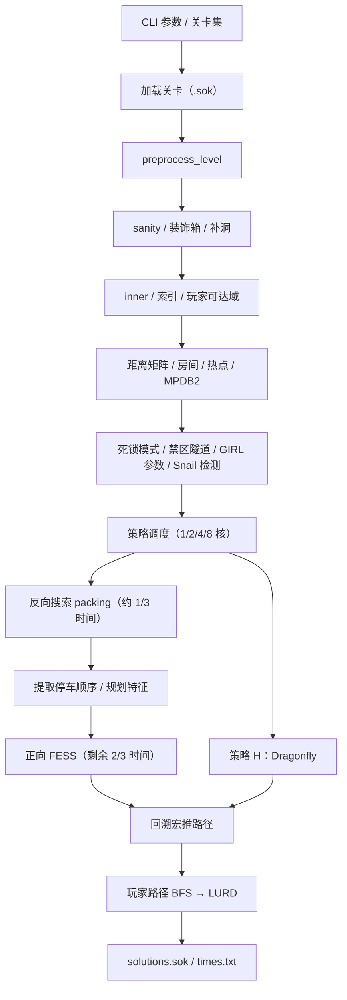
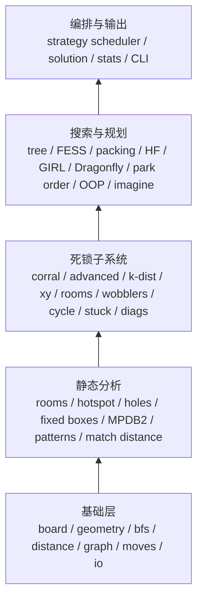

# Festival 3.1 → festival-rs：Rust 重写计划

| 项目 | 内容 |
|---|---|
| 文档状态 | Draft v1，待评审 |
| 编写日期 | 2026-10-27 |
| 源项目 | Festival 3.1（C++，作者 Yaron Shoham） |
| 源目录 | `D:\Users\sms\Desktop\Repos\festival` |
| 目标仓库 | `D:\Users\sms\Desktop\Repos\festival-rs` |
| 目标版本 | `festival-rs 1.0`：行为等价移植 |
| 当前进展 | Phase 0/1/2/3/4/5 完成；策略 A/B/D/E/F/G 在 Microban 1–80 上解题集一致（Gate G4），策略 C 与 C++ 解题集及总步数/推数完全一致、策略 H 解题集一致（Gate G5），GIRL score/value 在 92,903 个样本上零差异（2026-10-27） |

> 本文既是技术路线图，也是验收契约。每个阶段都有交付物和 Gate；未通过 Gate 不进入下一阶段。

---

## 1. 摘要

Festival 是一个高性能 Sokoban（推箱子）求解器，核心是 **FESS（Feature Space Search）**，辅以 **GIRL（Greedy Iterations / Reinforcement Learning）**、**Dragonfly（曼哈顿距离贪心）**，以及一整套死锁检测与剪枝子系统。程序默认按 1/2/4/8 核调度 8 种策略，每种策略由“反向 packing 搜索 → 规划特征 → 正向 FESS 搜索”组成。

本次重写不是“换个语言抄一遍”，而是一次**带测试契约的架构重写**：

- 保留算法语义与解题能力，移除全局可变状态、裸指针和平台耦合；
- 用 Rust 的值类型、arena 索引、`Result`、`std::thread` 重建可维护、可测试、跨平台的求解器；
- 以 C++ 原版作为**差分测试基准**，逐阶段验证静态分析、死锁判定、搜索行为与最终解题结果；
- 性能目标：解题率不低于原版，单线程耗时不超过原版 1.25 倍，内存不超过 1.2 倍。

预计单人全职 **27–36 周（约 6.5–9 个月）**；若两人并行开发，可压缩到 **18–24 周**。里程碑如下：

| 里程碑 | 内容 | 累计周（单人） |
|---|---|---|
| M0 | C++ 基准、测试语料、工程脚手架 | 1–2 |
| M1 | 基础层与静态分析通过差分校验 | 4–6 |
| M2 | FESS 最小闭环，端到端产出合法解 | 7–10 |
| M3 | 死锁子系统与 C++ 判定一致 | 12–16 |
| M4 | packing / 规划 / HF 家族达到策略等价 | 17–23 |
| M5 | GIRL 与 Dragonfly 等价 | 20–27 |
| M6 | 8 策略调度与多核完整兼容 | 23–30 |
| M7 | 性能、稳定性、内存达标 | 26–34 |
| M8 | 1.0 发布 | 27–36 |

---

## 2. 目标、范围与成功标准

### 2.1 目标

1. **功能等价**：关卡解析、命令行参数、策略调度、解文件与日志格式保持兼容。
2. **算法等价**：8 种顶层策略、所有嵌套死锁搜索、所有评分与剪枝语义全部移植。
3. **工程质量**：
   - 默认 `#![forbid(unsafe_code)]`，不得以 unsafe 规避借用检查；
   - 无全局可变状态，单线程运行可复现；
   - 解析、移动生成、死锁判定等模块具备单元测试与属性测试；
   - Windows / Linux / macOS 均可构建运行。
4. **性能与解题能力**：
   - 相同机器、相同核数、相同每关时限下，解题集合与 C++ 基准一致；
   - 单线程运行时间 ≤ 1.25× C++，目标 ≤ 1.10×；
   - 峰值内存 ≤ 1.2× C++；
   - 8 线程可稳定运行，无数据竞争。
5. **可维护性**：模块边界清晰，新增 SearchMode 或死锁检测不需要修改全局状态。

### 2.2 非目标（1.0 之前）

- 不改进算法强度，不新增启发式，不更换策略表；
- 不做 GUI、Web 服务、WASM、分布式求解；
- 不要求搜索轨迹逐节点完全一致（时限搜索本身依赖墙上时钟，C++ 多线程结果也不确定）；
- 不重写关卡集或死锁模式库的内容。

### 2.3 成功标准（Definition of Done）

| 维度 | 1.0 验收标准 |
|---|---|
| 解题正确性 | 所有输出的 LURD 解均可独立回放，最终所有箱子在目标上；非法推数 0 |
| 解题能力 | 基准关卡集中，C++ 能解出的关卡 Rust 也必须解出（同一机器、同一时间/核数预算） |
| 解质量 | 总推数（pushes）≤ C++ 基准 102%，总步数（moves）≤ 105%；个体差异需记录 |
| 耗时 | 单线程 ≤ 1.25× C++；8 线程扩展效率不低于 C++ 的 80% |
| 内存 | 峰值 RSS ≤ 1.2× C++（相同 `-time`、`-cores`、`-extra_mem`） |
| 稳定性 | 24 小时压力运行无 panic、无死锁、无内存增长 |
| 兼容性 | 第 12 节 CLI 参数表和 `solutions.sok` / `times.txt` 语义兼容 |
| 代码质量 | `cargo fmt --check`、`cargo clippy -D warnings`、测试全绿、无 unsafe |

---

## 3. 源项目解剖

### 3.1 规模与构建

| 指标 | 数值 |
|---|---|
| 实现文件 | 62 个 `.cpp` |
| 头文件 | 61 个 `.h` |
| 实现代码 | 22,535 行 |
| 头文件代码 | 1,305 行 |
| 合计 | 23,840 行 |
| 语言风格 | C++ 编译器下的 C 风格过程式代码；结构体 + 全局数组 + 裸指针，几乎无 STL |
| 构建（README） | `gcc -O3 *.cpp -pthread -DTHREADS`（Windows / mingw64） |
| 外部资源 | 仅关卡文件；死锁模式内嵌在 `textfile.cpp`，无外部数据文件 |
| 默认关卡集 | `XSokoban`，从 `./levels/XSokoban.sok` 读取 |
| 默认每关时限 | 600 秒 |
| 默认并行 | 自动检测 CPU 与内存，可选择 1/2/4/8 核 |

**环境现状**：当前开发机已安装 Rust 1.99.1，但**没有 gcc/g++**。搭建 C++ 基准需要 MSYS2 UCRT64（`mingw-w64-ucrt-x86_64-gcc`）、WSL2（Ubuntu + `g++`）或 CI（Ubuntu）。这是 Phase 0 的第一个阻塞项。

Linux 构建需额外定义 `LINUX`（源码通过 `#ifndef LINUX` 选择 Windows 控制台/内存检测分支），且 `sol.cpp` 使用 `<malloc.h>`，建议在 Linux 上验证后固定构建命令。

### 3.2 运行时流程



关键语义（必须复刻）：

- `start_time` 在 `preprocess_level` **之前**设置，因此预处理时间计入每关时限。
- 每关先写入 `solutions.sok` 的题目与初始盘面，再求解；求解成功追加解。
- 失败原因写入 `global_fail_reason`，最终进入 `times.txt`。
- `-save_best` 即使未解出也保存“最佳位置”对应的部分解。
- `-out_file` 进入 YASC 模式：不写 `times.txt`，只写指定解文件。
- 多核时任一核解出即设置 `any_core_solved`，其他核在下一次外层循环退出。

### 3.3 八策略矩阵

`solve_with_alg` 中硬编码 8 组策略，反向搜索占 1/3 时间，正向搜索占剩余时间：

| # | 策略 | 反向搜索 | 正向搜索 | 计划阶段 | 说明 |
|---|---|---|---|---|---|
| 0 | A | `BASE_SEARCH` | `FORWARD_WITH_BASES` | Phase 4a | 通过 sink square 消除箱子 |
| 1 | B | `MAX_DIST_SEARCH2` | `HF_SEARCH` | Phase 4b | 距离/HF 特征 |
| 2 | C | `GIRL_SEARCH` | `GIRL_SEARCH` | Phase 5 | RL / ε-greedy |
| 3 | D | `HF_SEARCH` | `HF_SEARCH` | Phase 4b | 纯 HF |
| 4 | E | `BICON_SEARCH` | `HF_SEARCH` | Phase 4b | 双连通特征 |
| 5 | F | `MAX_DIST_SEARCH` | `HF_SEARCH` | Phase 4b | 最大距离特征 |
| 6 | G | `REV_SEARCH` | `REV_SEARCH` | Phase 4b | 反向打包 + 正向墙化 |
| 7 | H | `DRAGONFLY` | `NAIVE_SEARCH` | Phase 5 / 6 | 小关卡快速贪心 |

调度规则：

| 核数 | 行为 |
|---|---|
| 1 | 顺序执行 8 个策略；第 i 个策略拿到剩余时间 `1/(8-i)` |
| 2 | 4 轮，每轮并行执行 2 个策略：`(0,1) (2,3) (4,5) (6,7)` |
| 4 | 2 轮，每轮并行执行 4 个策略：`(0..3) (4..7)` |
| 8 | 8 个策略同时启动，共享整段剩余时间 |
| `-alg N` | 强制执行策略 N，占用全部剩余时间（用于调试/测试） |

### 3.4 SearchMode 清单

| 值 | 名称 | 用途 | 计划阶段 |
|---|---|---|---|
| 0 | `NORMAL` | 通用 FESS；也作为内部降级模式 | Phase 2 |
| 1 | `DEADLOCK_SEARCH` | 死锁区域搜索 | Phase 3 |
| 2 | `BASE_SEARCH` | 反向后向：以初始箱子位置为 base | Phase 4a |
| 3 | `K_DIST_SEARCH` | k-距离死锁搜索 | Phase 3 |
| 4 | `MINI_SEARCH` | 小规模搜索（死锁判定子程序） | Phase 3 |
| 5 | `FORWARD_WITH_BASES` | 正向策略 A | Phase 4a |
| 6 | `GIRL_SEARCH` | RL 特征评分 + ε-greedy | Phase 5 |
| 7 | `REV_SEARCH` | 反向模式（墙化/imagined） | Phase 4b |
| 8 | `DRAGONFLY` | 优先队列贪心 | Phase 5 |
| 9 | `WOBBLERS_SEARCH` | wobblers 死锁搜索 | Phase 3 |
| 10 | `HF_SEARCH` | HF 评分（含 imagined 距离） | Phase 4b |
| 11 | `ROOMS_DEADLOCK_SEARCH` | 房间死锁搜索 | Phase 3 |
| 12 | `NAIVE_SEARCH` | 朴素评分（策略 H 正向） | Phase 6 |
| 13 | `XY_SEARCH` | XY 死锁搜索 | Phase 3 |
| 14 | `MINI_CORRAL` | 小型 corral 判定 | Phase 3 |
| 15 | `IGNORE_CORRAL` | 关闭 corral 剪枝的降级模式 | Phase 2/3 |
| 16 | `BICON_SEARCH` | 双连通评分 | Phase 4b |
| 17 | `MAX_DIST_SEARCH` | 最大距离评分 | Phase 4b |
| 18 | `MAX_DIST_SEARCH2` | 最大距离评分（变体） | Phase 4b |
| 19 | `SNAIL_SEARCH` | Snail 关卡专用评分 | Phase 6 |
| 20 | `NETLOCK_SEARCH` | Netlock 关卡专用评分 | Phase 6 |

### 3.5 模块分层



### 3.6 关键全局状态

| C++ 全局对象 | 用途 | Rust 归属 |
|---|---|---|
| `height`, `width`, `initial_board`, `inner`, `index_num`, 索引映射表 | 关卡几何与静态信息 | `LevelContext`（不可变，按关卡共享） |
| `distance_from_to`, `bfs_distance_from_to`, `impossible_place` | 推/拉距离矩阵 | `LevelDistances`（不可变） |
| `rooms_board`, `rooms_num`, `base_graph` | 房间划分与房间连通图 | `LevelAnalysis`（不可变） |
| `targets_reachable_from`, `blocks_place`, `completely_blocks` | 热点表 | `LevelAnalysis`（不可变） |
| `patterns`, `pull_patterns` | 静态死锁模式（含旋转/翻转） | `OnceLock<DeadlockPatterns>`（进程级只读） |
| `forbidden_push_tunnel`, `forbidden_pull_tunnel` | 隧道禁区 | `LevelContext` |
| `perimeter` | 正/反向搜索之间的前沿哈希表 | `SharedRun` 中的带锁表（C++ 已加锁） |
| `deadlock_cache` | 死锁判定缓存 | 线程本地缓存或分片锁缓存（见 4.5） |
| `k_dist` 哈希、stuck patterns | 死锁学习/记忆 | 每关共享 + 锁，或线程本地后合并 |
| GIRL 距离/权重表、`snail_level_detected` | 关卡级 RL / 特殊关卡检测 | `LevelAnalysis` |
| `any_core_solved` | 全局取消标志 | `AtomicBool` |
| `start_time`, `end_time`, `time_limit` | 计时 | `Clock` / `RunConfig` |
| `global_fail_reason` | 失败原因 | 线程结果聚合，不用共享 `char[]` |
| 全局统计（`global_total_moves` 等） | 汇总日志 | `RunStats`（主线程汇总） |
| `dragonfly_nodes`, `dragonfly_roots` | Dragonfly 节点池 | 线程本地 `DragonflySearch` |
| `global_dir`, `level_set_name`, `output_filename` | 路径与模式 | `RunConfig` |

### 3.7 资源画像

- C++ 每核搜索树默认 `log_size = 23`，源码注释称约 **1.5 GB/核**；8 核约 12 GB。
- `log_size` 由 `-extra_mem` 调整；Dragonfly 在 8 核模式下最多 `2^25` 个节点（约 512 MB）。
- 关卡静态矩阵按 `MAX_INNER = 51×51 = 2601` 分配：
  - `distance_from_to[2601][2601]` 约 27 MB；
  - 另有 BFS 距离矩阵、热点矩阵，合计可达约 100 MB。
- 这些大数组在 Rust 中**不能放在栈上或静态区**，必须使用 `Vec` / `Box<[T]>` 堆分配。
- C++ 大量使用栈上的 `board b`（2.6 KB）和 `move moves[MAX_MOVES]`（约 180 KB），Rust 需改为上下文复用缓冲区或确保栈足够。

### 3.8 代码陷阱、平台耦合与死代码

**必须处理的陷阱：**

1. **全局状态耦合**：几乎所有模块直接读写全局变量；端口必须先把隐式依赖显式化。
2. **固定数组与零填充**：`board` 是 `51×51`，关卡外的单元格为 0；合法性依赖关卡被墙包围（`sanity_checks` 拒绝玩家能离开棋盘的关卡）。Rust 若改为动态尺寸，必须保持等价语义。
3. **哈希公式**：`hash = hash * 12345 + cell + (hash >> 32)`，使用 64 位无符号回绕。建议逐字节保留，便于差分测试。
4. **整数溢出**：C++ 依赖无符号回绕，部分 `int` 运算可能溢出。Rust debug 模式会 panic。需明确：哈希/权重使用 `wrapping_*`，其余热路径开启溢出检查并修正。
5. **`exit_with_error` + `my_getch()`**：C++ 出错时会等待按键，CI 会挂起。Rust 必须改为 `Result`，仅在显式交互模式暂停。
6. **平台差异**：`util.cpp` 使用 `SYSTEM_INFO` / `GlobalMemoryStatusEx`，`io.cpp` 使用 Win32 控制台 API；Rust 用 `std` + 可选 `sysinfo`，颜色输出检测 TTY。
7. **时间粒度**：C++ 用 `time(0)`（秒），`start_time` 在预处理前设置；热点初始化也会读取全局 `start_time` 中止。Rust 用 `Instant`，但日志仍输出整秒。
8. **多线程共享**：`any_core_solved` 非原子；`deadlock_cache`、`k_dist` 哈希、stuck patterns 未见显式同步，存在数据竞争风险；只有 `perimeter` 和棋盘打印有互斥锁。Rust 必须显式同步或线程本地化。
9. **初始化顺序**：`initial_board` 是在预处理（装饰箱、补洞、裁掉外部箱子）之后才保存的。端口不能把它理解成“原始输入盘面”。
10. **大栈数组**：`move moves[MAX_MOVES]`、`int_board dist` 等出现在递归/深层调用中，Windows 默认 1 MB 栈可能紧张；Rust 默认 2 MB，但递归 `back_propagate_values_tree` 仍需改为迭代或加大栈。

**死代码/未引用代码（不迁移或仅作测试工具）：**

| 文件 | 结论 |
|---|---|
| `order.cpp` | `set_order` / `score_using_order` 仅在本文件内出现，未被调用；不迁移 |
| `lurd.cpp` | `lurd_to_moves` 仅在自身测试函数中使用；可作为测试校验器参考，不进入核心 |
| `interseting.h` | 无对应 `.cpp`，无引用；忽略 |
| `margin.h` | 空文件；忽略 |

---

## 4. Rust 目标架构

### 4.1 Workspace 布局

```text
festival-rs/
├── Cargo.toml                  # [workspace]
├── crates/
│   ├── festival-core/          # 纯算法库，无 CLI 依赖
│   │   ├── src/
│   │   │   ├── lib.rs
│   │   │   ├── constants.rs
│   │   │   ├── config.rs
│   │   │   ├── board/{mod,geometry,hash,render}.rs
│   │   │   ├── level/{mod,parser,preprocess,validate}.rs
│   │   │   ├── bfs.rs
│   │   │   ├── distance.rs
│   │   │   ├── graph.rs
│   │   │   ├── moves.rs
│   │   │   ├── analysis/{mod,rooms,hotspot,holes,biconnect,envelope,match_distance}.rs
│   │   │   ├── deadlock/{mod,patterns,static_checks,zone,fixed,corral,advanced,
│   │   │   │            hungarian,corral_search,k_dist,xy,rooms,wobblers,
│   │   │   │            cycle,learned,diags,mini,cache}.rs
│   │   │   ├── search/{mod,tree,queue,features,advisors,score,fess,packing,
│   │   │   │           positions,hf,girl,greedy,dragonfly,naive,max_dist,
│   │   │   │           snail,perimeter,opener}.rs
│   │   │   ├── planning/{mod,park_order,oop,imagine,overlap,heuristics}.rs
│   │   │   ├── io/{mod,sok,solution,stats,lurd}.rs
│   │   │   ├── solver/{mod,context,strategy,schedule,clock}.rs
│   │   │   └── diagnostics.rs
│   │   ├── tests/              # 集成测试、golden/golden-diff
│   │   └── benches/
│   ├── festival-cli/           # 二进制入口，仅做参数解析与输出
│   │   └── src/main.rs
│   └── festival-bench/         # 基准/差分对比驱动
│       └── src/main.rs
├── levels/                     # 冒烟关卡；外部基准集按脚本下载
├── reference/                  # C++ 基准构建脚本 / 可选源码快照（保留版权）
├── scripts/                    # 运行、对比、生成 fixture
├── docs/
└── .github/workflows/
```

**为什么用 workspace**：核心库可被 CLI、bench、未来的库用户复用；差分测试驱动与 CLI 解耦；避免 `main.rs` 膨胀。

### 4.2 状态模型：消灭全局变量

用四层上下文替代全局状态：

```rust
/// 每关一份，预处理后不可变，线程间共享（Arc 或 scoped borrow）。
pub struct LevelContext {
    pub width: usize,
    pub height: usize,
    pub initial: Board,                 // 预处理后的初始盘面
    pub inner: BitBoard,
    pub index_of: Vec<Index>,
    pub coords: Vec<(u8, u8)>,
    pub distances: Distances,
    pub rooms: Rooms,
    pub hotspots: Hotspots,
    pub forbidden_push: BitBoard,
    pub forbidden_pull: BitBoard,
    pub girl: GirlParams,
    pub snail: SnailParams,
}

/// 整次运行不变：CLI、路径、核数、内存预算。
pub struct RunConfig { /* time_limit, cores, tree_log_size, out_dir, ... */ }

/// 跨线程共享的可变状态，全部显式同步。
pub struct SharedRun {
    pub cancelled: AtomicBool,
    pub perimeter: Mutex<Perimeter>,
    pub deadlock_cache: DeadlockCache,       // 见 4.5：先线程本地，后分片
    pub learned_patterns: RwLock<LearnedPatterns>,
    pub stats: Mutex<RunStats>,
    pub output: Mutex<OutputFiles>,
}

/// 每个搜索线程/每个策略一份。
pub struct ThreadContext<'a> {
    pub level: &'a LevelContext,
    pub shared: &'a SharedRun,
    pub tree: Tree,
    pub helper: Helper,
    pub positions: PositionsArena,
    pub scratch: Scratch,                    // moves / boards / queues 复用缓冲
    pub clock: SearchClock,
}
```

原则：

- `height` / `width` / `initial_board` / `inner` 不再全局；所有函数显式接收 `&LevelContext`。
- 求解线程只写自己的 `Tree` / `Helper`，通过 `SharedRun` 通信。
- `global_fail_reason` 改为每个线程返回 `SolveOutcome { solved, reason, elapsed, pushes }`，主线程聚合。
- `verbose` 作为 `Diagnostics` 配置传入，不在库内部直接 `printf`。

### 4.3 核心类型与 arena 设计

C++ 的 `tree` 内部有大量裸指针（`expansion_data *father`、`score_element *best_past`、`UINT_8 *b`），Rust 不能照搬。统一改为**稳定索引**：

```rust
pub type NodeId = u32;          // u32::MAX = 空
pub type ExpansionId = u32;
pub type BoardOffset = u32;

pub struct NodeElement {
    pub hash: u64,
    pub score: Score,
    pub expansion: ExpansionId, // u32::MAX = 未展开
    pub deadlocked: bool,
}

pub struct ExpansionData {
    pub node: NodeId,
    pub board_offset: BoardOffset,
    pub father: Option<ExpansionId>,
    pub move_hash_start: u32,
    pub moves_num: u16,
    pub best_move: i16,          // -1 = 无
    pub best_weight: i32,
    pub best_score: Score,
    pub best_past: NodeId,       // 替代 score_element*
    pub label: u16,
    pub has_corral: bool,
    pub weight: i32,
    pub depth: u16,
    pub subtree_size: u32,
    pub next_son_to_check: u16,
    pub leaf_direction: u8,
    pub advisors: Advisors,
}

pub struct Tree {
    hash_table: Vec<NodeId>,     // 开放寻址，u32::MAX 表示空
    nodes: Vec<NodeElement>,
    expansions: Vec<ExpansionData>,
    move_hashes: Vec<MoveHashData>,
    boards: Vec<u8>,             // stride = height * width，而非 MAX_SIZE²
    queues: Vec<IndexedHeap>,
    pull_mode: bool,
    search_mode: SearchMode,
}
```

要点：

- **board arena 的 stride 使用 `height×width`**，与 C++ 一致；不要每节点存 `51×51`。
- `best_past` 存 `NodeId`，访问时 `tree.nodes[id].score`。
- `father` 存 `ExpansionId`，避免自引用。
- 哈希表值用 `u32::MAX` 作为空哨兵；不要用 `-1` 的 `i32`，避免类型混乱。
- 队列比较器同时需要 `&Tree` 和 `&mut heap`。设计为 `IndexedHeap::pop_best(&mut self, tree: &Tree)`，或把 `(weight, score)` 快照存入堆元素。不得使用 `Rc<RefCell<...>>` 等运行时借用。
- `Tree` 容量在创建时按 `tree_log_size` 计算，后续不扩容；容量不足返回 `ResourceExhausted("Max nodes reached")`。
- `PositionsArena` 同理：`Vec<Position>` + board arena + move arena，替代 `positions.cpp` 中的多块 `malloc`。

### 4.4 搜索树与队列语义

必须保持的行为细节：

1. **哈希表**：开放寻址、线性探测、`hash & mask`，与 C++ 相同；`find_node_by_hash` 的探测顺序影响“先找到哪个节点”，进而影响结果。
2. **队列排序**：先比较 `best_weight`，再调用 `is_better_score`，最后按 expansion 索引升序（`first < second`）。不能用 `BinaryHeap` 默认 `Ord`；实现自定义 `IndexedHeap`，支持 `remove_value_from_queue`。
3. **`best_move_in_tree` 的“弹出-检查-重插”循环**：保持原逻辑，不要改成一次性排序。
4. **request/feature cell**：`MAX_REQUESTS = 10000`，环形消费 `requests_pos`，以及 `set_next_request_to_score` 的回卷语义。
5. **label 分配**：`get_label_of_score` / `get_label_of_request` / `get_label_of_pack_request` 的字段组合必须完全一致；否则特征空间被切错，搜索行为不可比。
6. **`set_best_move`**：相等 weight 时按 score 比较；GIRL 模式下跳过 score 比较；无可用子节点时调用 `set_deadlock_status`。
7. **GIRL 的 `subtree_size % inv_epsilon`** 决定是否走 cyclic son；保持整数语义。
8. **`block_existing_sons_tree`**：用于森林根去重，依赖节点插入顺序。

建议为 `Tree` 实现 `#[cfg(test)]` 的验证函数：哈希表项数 = 节点数、父链无环、board arena 不越界、move_hash 区间不重叠。

### 4.5 并发模型

- 使用 `std::thread::scope`，每个策略一个线程；不使用 Rayon（任务是长时、异构、带取消的搜索，不是数据并行）。
- 线程间只共享：
  - `AtomicBool cancelled`（对应 `any_core_solved`）；
  - `Mutex<Perimeter>`（C++ 已在 `perimeter.cpp` 中加锁）；
  - `RwLock<LearnedPatterns>`（stuck patterns 会被搜索过程中学习并写入）；
  - 输出/统计锁。
- **死锁缓存**：C++ 的 `deadlock_cache` 是全局无锁表，多个核并发读写。Rust 不能复刻这个数据竞争。建议：
  1. 第一版：**线程本地缓存**（每个 `ThreadContext` 一份），行为安全但跨核命中率下降；
  2. 第二版：分片 `Mutex` 缓存，或 `DashMap` 风格的并发哈希；以基准测试决定；
  3. 无论哪种，缓存命中只影响性能，不影响判定正确性；差分测试必须覆盖“缓存关闭/开启”两种模式。
- `perimeter` 的跨核共享会影响搜索路径，因此多核结果本身无法完全确定；提供 `--cores 1` 作为可复现模式。
- 取消检查点：与 C++ 一样，放在每次主循环迭代开头；不要在每个子函数里查原子变量，避免开销。
- 线程 panic 处理：`scope` 会传播 panic；捕获后转换为 `SolveError::ThreadPanic`，并清理输出文件句柄。

### 4.6 内存策略

1. **按预算分配**：保留 `-extra_mem` 语义，同时新增 `--mem-budget-mb`；树节点数上限由预算反推。
2. **`try_reserve_exact`**：所有大块 `Vec` 使用可失败分配；OOM 时返回“Max nodes reached”或明确错误，而不是让进程 abort。
3. **复用 scratch**：`find_possible_moves` 的 `moves[MAX_MOVES]`、临时 `board`、BFS 队列放入 `Scratch`，按线程复用。
4. **避免超大静态数组**：所有 `MAX_INNER × MAX_INNER` 矩阵堆分配。
5. **内存测量**：Windows 用 `GetProcessMemoryInfo`，Linux 读 `/proc/self/status`，macOS 用 `task_info`；封装在 `diagnostics::peak_rss()`，仅测试/日志使用。
6. **分配器**：先使用系统分配器；若 Windows 上碎片/性能明显，再评估 `mimalloc`（feature flag，不改变语义）。

### 4.7 时间与预算

```rust
pub struct SearchClock {
    started: Instant,
    deadline: Option<Instant>,
    max_expansions: Option<u64>, // 测试/确定性模式
}
impl SearchClock {
    pub fn expired(&self) -> bool { ... }
    pub fn should_stop(&self, expansions: u64) -> bool { ... }
}
```

- 生产模式：每关 `time_limit` 秒，检查间隔与 C++ 一致（每次主循环迭代一次）。
- 测试/差分模式：`--max-expansions N` 关闭时间限制，使 C++ 与 Rust 都按固定节点数停止，便于逐节点对比。
- 日志中的 `Solver time` 输出整秒，格式 `HH:MM:SS`，与 C++ 一致。
- `hotspot` 初始化的“耗时超过 1/4 时限则中止”语义用 `SearchClock` 实现；不要读全局 `start_time`。

### 4.8 错误处理、panic 与 unsafe 政策

- 库层返回 `Result<T, SolveError>`；CLI 负责打印与退出码。
- `SolveError` 至少包含：`Parse`、`InvalidBoard`、`ResourceExhausted`、`TimeLimit`、`NoPackingOrder`、`TooManyMoves`、`Internal(String)`、`Io`。
- 库内禁止 `println!`；使用 `Diagnostics` trait 或 `log` 宏。
- **禁止 `unwrap()` / `expect()` 处理外部输入**；内部不变量可用 `debug_assert!`。
- `#![forbid(unsafe_code)]` 在 `festival-core` 中开启。只有在 Phase 7 性能分析证明必要、且通过 Miri/属性测试后，才允许在独立 `perf` 模块中使用 `unsafe`，并附 safety 注释。
- 递归函数（`heapify`、`back_propagate_values_tree`、`biconnect_dfs`）改为显式栈，或确保最大深度 ≤ 1500 并在测试中覆盖。
- 失败原因字符串与 C++ 对齐（用于 `times.txt`）：`Invalid board`、`Too many boxes`、`too many rooms`、`Could not find packing order`、`Too many moves`、`Max nodes reached`、`Time limit exceeded`、`Size is too big`。

### 4.9 依赖选择

| 用途 | 选择 | 说明 |
|---|---|---|
| CLI | `clap` 4（derive） | 参数兼容；`--help` 自动生成 |
| 错误 | `thiserror` | 库层错误类型 |
| 日志 | `log` + `env_logger` | 替代全局 `verbose` 分散打印；保留数字级别映射 |
| 线程数 | `std::thread::available_parallelism` | 无需 `num_cpus` |
| 物理内存 | `sysinfo`（可选 feature） | 仅用于自动核数/预算；也可要求用户显式传参 |
| 测试 | `proptest`、`insta`（可选） | 属性测试 + golden 快照 |
| 基准 | `criterion`（微基准）、自研 `festival-bench`（端到端） | 端到端不适合 criterion |
| 模糊测试 | `cargo-fuzz`（dev 工具） | 解析器、LURD、图搜索 |
| 序列化 | `serde` + `serde_json`（仅 trace/fixture） | 生产路径不依赖 |

原则：核心算法不引入重量级运行时；不引入 async；不引入 Rayon/Tokio。

### 4.10 兼容性策略

- 保持 C++ 的 64 位盘面哈希公式，便于差分测试与调试日志对比。
- 保持 tile 位标志数值：`WALL=1, BOX=2, TARGET=4, SOKOBAN=8, BASE=16, DEADLOCK_ZONE=32`。
- 保持 `MAX_SIZE=51`、`MAX_BOXES=200`、`MAX_SOL_LEN=1500`、`MAX_MOVES=11500`、`MAX_ROOMS=70`。
- 输出 `solutions.sok` 的段落顺序与字段；具体空格/日期格式逐步对齐，非关键格式允许差异但需在文档中声明。
- CLI 支持原参数；新增参数不得改变默认行为。

---

## 5. 分阶段路线图

> 每个阶段都包含：目标、工作项、交付物、Gate、工期、主要风险。工期以单人全职计。

### Phase 0：基准、语料与工程脚手架（1–2 周）

**目标**：在写第一行求解器代码之前，先具备“可对照、可回归”的环境。

**工作项**

1. **C++ 基准构建**
   - 当前机器无 g++；安装 MSYS2 UCRT64 或 WSL2 Ubuntu。
   - Windows：按 README 使用 `gcc -O3 *.cpp -pthread -DTHREADS`。
   - Linux：`g++ -O3 -DLINUX -DTHREADS *.cpp -pthread -o festival-cpp`（以实际可编译命令为准）。
   - 记录源提交 `f7c0231`、编译器版本、命令行到 `reference/BASELINE.md`。
2. **参考驱动 `refcheck`**
   - 在 `reference/` 下维护一个**独立于上游**的驱动/补丁（不修改原仓库行为）：
     - `refcheck hash <level>`：输出初始盘面、预处理后盘面、哈希；
     - `refcheck static <level>`：输出距离矩阵、房间、热点、MPDB2、死锁模式数量等；
     - `refcheck deadlock <boards.txt>`：对一批盘面输出 `board_is_deadlocked` / `move_is_deadlocked`；
     - `refcheck trace <level> -alg N -max-expansions M`：输出 JSONL（迭代号、节点哈希、label、score 字段、选择 move、死锁判定）；
     - `refcheck solve <set> -time T -cores C`：生成基准结果清单。
   - 补丁需带明确标记，便于后续同步上游；如不修改上游，可复制一份到 `reference/cpp-ref/` 并保留全部版权头。
3. **测试语料**
   - `levels/smoke/`：自建 12 关（3 个单箱、3 个走廊/隧道、3 个多房间、3 个死锁陷阱），无版权问题。
   - 外部基准集：Microban I/II、XSokoban、SokHard、Sasquatch、Grigr2001/2002、Sven、Yoshio Murase、Aymeric 等。先写下载脚本 + 校验和 + 许可说明，确认许可后再 vendoring。
4. **对比与校验工具**
   - `scripts/run_set.sh`：分别运行 C++ / Rust，输出统一 CSV；
   - `scripts/compare.py`：按关卡比较 solved/time/pushes/moves；
   - 独立的 LURD 回放校验器（Rust 测试二进制）：验证每一步合法、最终完成、统计推数/步数。
5. **Rust 脚手架**
   - 将现有单 crate 改为 workspace（`festival-core`、`festival-cli`、`festival-bench`）。
   - `cargo fmt` / `clippy` / CI（Windows + Linux + macOS）、`cargo-deny`、license/NOTICE 占位。
   - CLI 骨架：`festival-rs <levels.sok> [options]`，`--help` 列出兼容参数。
6. **文档**：本计划入库；确定分支策略与提交规范。

**交付物**

- 可运行的 C++ 基准二进制与 `refcheck`；
- 12 关冒烟集 + 外部集下载脚本；
- 对比脚本、CSV schema、LURD 校验器；
- workspace 骨架与 CI 绿灯。

**Gate G0**

- C++ 基准在冒烟集上稳定运行并生成结果；
- `refcheck` 四种模式可用；
- Rust 骨架可构建、`--help` 可运行；
- 所有基准结果与构建命令记录在 `reference/BASELINE.md`。

**风险**：C++ 代码在非 Windows 平台编译问题（`malloc.h`、`conio.h`、`LINUX` 宏、`timeb.h`）。缓解：优先 Windows MSYS2；Linux 仅用于 CI 差分，必要时打平台兼容小补丁。

---

### Phase 1：基础层、关卡 I/O 与静态分析（3–4 周）

**目标**：完成所有“无搜索”的确定性模块，并用 C++ 输出做逐值校验。

**工作项**

1. **常量与配置**：`constants.rs`、`config.rs`、`SolveError`、`Diagnostics`。
2. **Board / Geometry**
   - `Board`（tile 位标志、固定 51×51 或等价安全表示）、`LevelGeometry`、`inner`、索引映射、玩家可达云、`apply_move`。
   - 哈希公式逐字节复刻；单元测试覆盖已知盘面。
3. **关卡 I/O**
   - `.sok` 解析：空格/`_`/`-`、`#`、`$`、`.`、`*`、`@`、`+`、`Title:`、`;` 注释、关卡间空行；文件路径规则（含扩展名/路径时直接使用）。
   - 渲染、`solutions.sok` 盘面输出。
   - LURD 解析/生成/回放校验。
4. **图与距离**
   - `bfs.rs`：连通性、连通分量、目标源标记、组扩展。
   - `distance.rs`：推/拉距离矩阵、不可达位置、BFS 距离。
   - `graph.rs`：`vertex` / `graph_data`、push/pull 加权图、可逆 move、宏推生成。
   - `moves.rs`：`box_can_be_moved`、`find_possible_moves`、kill/base move、corral 检测接口（先留 trait/函数桩）。
5. **静态分析**
   - `rooms.rs`、`hotspot.rs`、`holes.rs`、`fixed_boxes.rs`、`envelope.rs`、`mpdb2.rs`、`biconnect.rs`、`match_distance.rs`、`hungarian.rs`。
   - 死锁模式数据从 `textfile.cpp` 转为 `const` 表，并在启动时生成旋转/翻转；保持模式顺序。
   - 禁区隧道、`set_forbidden_tunnel`。
6. **预处理**
   - `sanity_checks`、`close_holes_in_board`、`turn_decorative_boxes_to_walls`、`init_inner`、`keep_boxes_in_inner`、保存预处理后的 `initial_board`。
   - 顺序必须与 C++ 完全一致；写测试固定住输出盘面。
7. **差分校验**
   - 对语料每一关比较：解析后盘面、预处理后盘面、哈希、`inner`、索引映射、距离矩阵、房间/热点/MPDB2 数量与数值。

**交付物**

- 可在 Rust 中加载、预处理、渲染、校验任意 `.sok` 关卡；
- 静态分析 dump 与 C++ 一致；
- 单元/属性测试与解析 fuzz target。

**Gate G1**

- 语料 100% 关卡：预处理盘面哈希一致；
- 距离/房间/热点/MPDB2 在抽样关卡上逐值一致；
- 解析器 fuzz 10 万输入无 panic；
- `cargo clippy -D warnings` 通过。

**风险**：`graph.cpp` 的 push/pull 图与不可达判定高度耦合，容易“看起来对但边界错”。缓解：用 C++ trace 中的 `find_possible_moves` 输出做逐 move 对比。

---

### Phase 2：FESS 最小闭环（3–4 周）

**目标**：打通“解析 → 搜索 → 解路径 → LURD”的端到端管道。此阶段只追求**正确性**，不追求解题率。

**工作项**

1. **Tree / Queue**
   - arena 索引版 `Tree`、`NodeElement`、`ExpansionData`、`MoveHashData`、开放寻址哈希表、`IndexedHeap`。
   - 实现 `set_root`、`expand_node`、`fill_expansion_structures`、`set_best_move`、`best_move_in_tree`、`set_deadlock_status`、`block_existing_sons_tree`。
2. **Score 框架**
   - `Score` 结构（字段、宽度、`f32 value`）、`is_better_score` 的 `NORMAL` / `FORWARD_WITH_BASES` 分支。
   - 先实现 `NORMAL` 所需的距离、房间、热点、连通性、`packed/oop/imagine` 默认 0 的桩。
3. **FESS 引擎**
   - `request` / `features`（环形请求队列、label 映射）。
   - 默认 advisor；`set_advisors_inner` 的其余 advisor 先返回默认值。
   - `perimeter` 基础版（插入、查询、`check_if_perimeter_reached`）。
   - `FESS` 主循环、时间/扩展数预算、`has_winning_move`、`learn_from_subtrees` 桩。
4. **死锁接口**
   - 统一 `DeadlockOracle`：`move_is_deadlocked`、`board_is_deadlocked`、`is_rooms_deadlock`。
   - Phase 2 只启用 Phase 1 的静态模式/2×2/固定箱检查；corral、matching、k-dist、wobblers 等返回 `false`（明确标记 `unimplemented`，不得静默返回错误结果）。
5. **解提取与输出**
   - `store_solution_in_helper`、`save_sol_moves`、`find_sol_move`（玩家路径 BFS）、LURD 输出、`solutions.sok`、`times.txt`。
   - 独立 LURD 校验器在每次输出后自动校验（debug 模式）。
6. **CLI 开发模式**
   - `--alg N` 强制执行策略；`--forward-only`（开发用）直接从初始盘面跑 FESS；`--max-expansions N` 用于差分。

**交付物**

- 单线程、单策略可从 `.sok` 得到合法 LURD 解；
- 解文件与日志可用 C++ 格式阅读；
- 端到端 integration test。

**Gate G2**

- 冒烟集 12 关全部能解析，至少 6 关可解；
- Microban 前 40 关在 `-alg 0 -cores 1 -time 60` 下至少解出 30 关（桩阶段允许低解题率，但必须无非法解）；
- 100 个语料关卡运行无 panic、无越界；
- 每个输出的解均通过独立校验器。

**风险**：Tree 的索引化改造容易出现“自引用/别名”语义偏差；建议先写不追求性能的直译版，再在 Phase 7 优化。

---

### Phase 3：死锁子系统（5–6 周）

**目标**：把 Festival 最核心的剪枝能力补齐，并使死锁判定与 C++ 一致。

建议拆成 3a / 3b / 3c 三个子阶段，每个子阶段单独 Gate。

#### Phase 3a：死锁基础（2 周）

- `deadlock_utils`：deadlock zone 的初始化、扩展、清除、pull/push 更新、`size_of_deadlock_zone`。
- `corral`：corral 检测、active corral、π-corral、corral options。
- `hungarian` + `match_distance`：匹配距离、Hungarian 求解与缓存。
- `advanced_deadlock`：`board_is_deadlocked`、`move_is_deadlocked`、`can_played_reversed`、`check_matching_deadlock`、pull 消除。
- `positions`：独立于 FESS tree 的 `PositionSet` arena（供 corral/k-dist/xy/rooms/wobblers 使用）。
- `corral_deadlock` + `deadlock_cache`：corral 深度搜索、缓存命中/查询计数、`learn_pull_deadlock`。

#### Phase 3b：其余死锁检测（2–3 周）

- `k_dist_deadlock`、`xy_deadlock`、`rooms_deadlock`、`wobblers`、`cycle_deadlock`、`diags`、`mini_search`。
- `stuck`：运行时学习模式、`learn_from_subtrees`、`recheck_tree_with_patterns`、`register_mini_corral`。
- 将 Phase 2 的 `DeadlockOracle` 桩替换为真实实现，保留 feature flag 以便二分定位。

#### Phase 3c：差分与调参（1–2 周）

- 从 C++ trace 中采样搜索树节点，构建 `boards.txt`；
- 对 `board_is_deadlocked` / `move_is_deadlocked` 做批量差分；
- 对缓存开启/关闭两种模式分别验证；
- 对 `corral_deadlock`、`k_dist`、`xy` 的搜索节点数/判定结果做抽查。

**Gate G3**

- 抽样 ≥100,000 个可达盘面：死锁判定与 C++ 一致率 ≥99.9%，且新增误判死锁（C++ 非死锁、Rust 死锁）为 0；
- 策略 A/B 的解题率相对 Phase 2 显著上升，达到 C++ 同策略的 ≥90%；
- 单次 `move_is_deadlocked` 平均耗时不超过 C++ 的 1.3×；
- 缓存关闭时结果不变（只影响性能）。

**风险**：`deadlock.cpp` 1290 行 + `corral_deadlock.cpp` 802 行，且互相递归调用；`stuck` 会改变全局学习状态。缓解：严格按调用图移植，先用“无学习、无缓存”的纯函数版本建立正确性，再打开学习/缓存。

---

### Phase 4：反向 packing、规划与 HF 家族（5–7 周）

建议拆成 4a / 4b。

#### Phase 4a：packing 与规划（2–3 周）

- `packing_search`：多根 pull 搜索、start zones、`declare_roots`、packing requests。
- `park_order`：停车顺序提取、验证、压缩、`conclude_parking`。
- `oop`：out-of-plan 区域、逐步距离。
- `overlap`：与完整停车顺序的重叠评分。
- `imagine`：imagined board、imagine score、imagined HF board。
- `heuristics`：base matching、sink squares、packing advisor、pull advisor。
- `BASE_SEARCH` / `FORWARD_WITH_BASES` 完整评分与 advisor。
- 策略 A 端到端。

#### Phase 4b：HF / REV / BICON / MAX_DIST（3–4 周）

- `hf_search`：HF 评分、hotspots、`get_distance_in_hf_search`、REV 评分与 advisor、`setup_rev_board`。
- `biconnect`、`max_dist`、`holes` 在评分中的使用。
- `match_distance` 的 imagine/base/rev 距离变体。
- 策略 B、D、E、F、G 的完整链路。
- `REV_SEARCH` 的正反向切换、`wallified` 棋盘、perimeter 交互。

**Gate G4**

- 策略 0、1、3、4、5、6 在冒烟集 + Microban 前 80 关上，解题集合与 C++ 同策略差异 ≤2%，且所有解合法；
- 策略 A 的解质量（总推数）≤ C++ 102%；
- packing order 与 C++ 语义一致：同一关卡在固定 `max-expansions` 下的停车顺序可逐项对比（允许顺序等价变体需记录）；
- 总耗时不超过 C++ 1.5×（Phase 7 再优化到 1.25×）。

**风险**：规划特征（park order / OOP / imagine）是 FESS 的“语义核心”，一个字段错位就会导致搜索退化。缓解：为 score 的每个字段建立独立差分测试，从 `refcheck trace` 逐字段比对。

---

### Phase 5：GIRL 与 Dragonfly（3–4 周）

**目标**：补齐策略 C 与 H，并验证 RL 相关数值语义。

**工作项**

1. **GIRL**
   - `girl_distance`、gamma 表、特征向量、硬编码权重（push 8 个、pull 6 个）；
   - `score_to_value`、`fill_girl_scores`、`handle_new_pos_in_girl_mode_tree`、值反向传播；
   - `greedy.cpp`：ε-greedy、`subtree_size`、cyclic son、`recompute_values_tree`；
   - `find_best_RL_parking_node`。
2. **Dragonfly**
   - 节点池、根节点、`dragonfly_get_board` 路径重建、优先队列比较器；
   - `dragonfly_expand_node`、corral move 剪枝、`perimeter` 交互；
   - 初始根、`dist_from_bases`、解路径输出。
3. **数值一致性**
   - `f32` / `f64` 运算顺序保持；不要用 `f64` 替换 `f32` 的 score.value；
   - 固定输入下 `score_to_value` 的结果与 C++ 逐位对比（允许极小 ULP 差异需记录）。

**Gate G5**

- 策略 2、7 在 C++ 能解出的关卡上解题率 ≥98%；
- GIRL 的 score/value 在 trace 节点上与 C++ 差异 <1e-5；
- Dragonfly 在 100 个关卡上无非法 move、无越界、无内存泄漏；
- 8 线程下 Dragonfly 节点池不共享，内存峰值符合预算。

**风险**：GIRL 的权重是训练得到的硬编码常量，必须逐字保留；Dragonfly 的 board 重建逻辑依赖 `0xff` 哨兵，Rust 需用 `Option` 或 `u8::MAX` 等价表达。

---

### Phase 6：完整调度、剩余模式与多核（3–4 周）

**工作项**

1. **剩余模式**
   - `NAIVE_SEARCH`（策略 H 正向）；
   - `SNAIL_SEARCH` / `NETLOCK_SEARCH`：关卡检测、评分、模式替换（`set_snail_parameters` / `set_netlock_parameters`）；
   - `MINI_CORRAL`、`IGNORE_CORRAL` 等内部降级模式。
2. **调度器**
   - 8 策略表、反向/正向时间切分、1/2/4/8 核调度、`-alg` 强制模式；
   - `any_core_solved` 原子取消；
   - `-save_best`、YASC `-out_file`、`times.txt` 汇总。
3. **多核正确性**
   - 每个线程独立 Tree/Helper/Positions/Scratch；
   - perimeter 加锁；deadlock cache 线程本地或分片；
   - `RunStats` 汇总顺序固定，日志可复现（除时间/线程调度）。
4. **CLI 完整兼容**
   - 原参数全部支持，默认值一致；
   - 新增参数（`--mem-budget-mb`、`--max-expansions`、`--forward-only`、`--validate`）不影响默认行为。

**Gate G6**

- 8 个策略均可单独运行；
- 1/2/4/8 核调度行为与 C++ 一致（同一关卡、同一时间预算下解题集合差异 ≤1%，逐条复核）；
- 完整语料（Microban + XSokoban 子集）解题集合与 C++ 一致；
- 多核运行无 data race（TSan 或 loom 子集）、无死锁、无 panic；
- `solutions.sok` / `times.txt` 可被下游工具读取。

**风险**：多核下共享缓存的语义差异导致结果偏移。缓解：提供 `--cores 1` 基准；多核 Gate 允许 ≤1% 差异并逐条记录原因。

---

### Phase 7：性能、内存与稳定性（3–4 周）

**工作项**

1. **基准**
   - 在固定机器、固定 CPU 亲和性、release 构建下运行 C++ 与 Rust；
   - 分阶段计时：解析、预处理、反向搜索、正向搜索、解输出；
   - 记录 expansions/s、nodes、push、moves、RSS。
2. **性能优化**
   - 热点：`find_possible_moves`、`graph` 迭代、`board` 拷贝、`get_connectivity`、`score_board`、`move_is_deadlocked`、队列操作；
   - 减少分配：scratch 复用、board arena、move 缓冲区；
   - 谨慎使用 `#[inline]`；避免 trait object；用 `match SearchMode` 而非动态分发；
   - 平台优化：LTO、`codegen-units=1`、可选 `target-cpu=native`。
3. **内存**
   - 调整树容量/board arena 增长率；
   - 验证 8 核 + Dragonfly 的峰值 RSS；
   - 加入 `try_reserve` 失败路径测试。
4. **稳定性**
   - `cargo-fuzz` 长时间运行解析器/移动生成/LURD；
   - Miri 跑纯逻辑单元测试；
   - ThreadSanitizer 跑多核冒烟；
   - 24 小时随机关卡集压力测试。
5. **可复现性**
   - `--cores 1` 下相同构建、相同参数输出稳定；
   - 记录并固定浮点运算顺序。

**Gate G7**

- 单线程总耗时 ≤1.25× C++；目标 ≤1.10×；
- 峰值 RSS ≤1.2× C++；
- 8 线程吞吐 ≥ C++ 的 80%；
- 24 小时压力无崩溃/泄漏；
- clippy/fmt/test/deny 全绿。

**风险**：安全 Rust 的边界检查导致 10–30% 性能损失；热点可能需要在隔离模块使用 `get_unchecked`。缓解：先测量再优化；任何 unsafe 必须有安全不变量注释、Miri 测试与代码评审。

---

### Phase 8：文档、发布与 1.0（1–2 周）

**工作项**

- 架构文档、模块图、状态模型说明；
- README：安装、构建、用法、兼容性矩阵、基准结果；
- `NOTICE` / `CREDITS`：保留 Festival 原始版权与作者署名；
- 版本策略、CHANGELOG、release CI（Windows/Linux/macOS 二进制）；
- 可选：把核心库 API 整理为 `festival-core` 的公开接口；
- 启动 v1.1 backlog（算法改进、WASM、GUI 等，均不在 1.0 范围）。

**Gate G8**

- 文档完整、CI 发布成功；
- 1.0 验收标准全部满足；
- 许可与署名经过确认。

---

## 6. 文件级迁移映射

> 行数为源文件 `.cpp` 行数；“复杂度”按 ★（低）到 ★★★★★（极高）评估。头文件随对应模块迁移，不单列。

### 6.1 基础与 I/O（Phase 1）

| C++ 文件 | 行数 | Rust 目标 | 复杂度 | 备注 |
|---|---:|---|---|---|
| `global.cpp` / `global.h` | 88 | `config.rs` / `constants.rs` | ★ | 去掉全局变量，改为配置与常量 |
| `board.cpp` / `board.h` | 794 | `board/{mod,geometry,hash}.rs` | ★★ | 位标志、inner、玩家云、哈希、反推 |
| `bfs.cpp` / `bfs.h` | 284 | `bfs.rs` | ★★ | 连通性、分量、目标源 |
| `distance.cpp` / `distance.h` | 176 | `distance.rs` | ★★ | 推/拉距离矩阵 |
| `graph.cpp` / `graph.h` | 977 | `graph.rs` | ★★★★ | 核心移动图；先生成 move 再谈搜索 |
| `moves.cpp` / `moves.h` | 353 | `moves.rs` | ★★★ | 宏推生成、apply、corral 钩子 |
| `preprocess.cpp` / `preprocess.h` | 197 | `level/preprocess.rs` | ★★ | 顺序敏感 |
| `io.cpp` / `io.h` | 601 | `io/{sok,render}.rs` | ★★ | 解析/渲染/颜色；跨平台重写 |
| `textfile.cpp` / `textfile.h` | 209 | `deadlock/pattern_data.rs` | ★ | 内嵌模式转 const |
| `util.cpp` / `util.h` | 258 | `util.rs` | ★ | 时间、核数、文本；去掉 getch |
| `lurd.cpp` | 87 | `io/lurd.rs` + 测试 | ★ | 仅作校验/工具 |
| `order.cpp` | 98 | 不迁移 | — | 死代码 |
| `interseting.h` / `margin.h` | 0 | 忽略 | — | 空/无实现 |

### 6.2 静态分析与预处理（Phase 1）

| C++ 文件 | 行数 | Rust 目标 | 复杂度 | 备注 |
|---|---:|---|---|---|
| `rooms.cpp` / `rooms.h` | 285 | `analysis/rooms.rs` | ★★★ | 房间划分与房间图 |
| `hotspot.cpp` / `hotspot.h` | 197 | `analysis/hotspot.rs` | ★★★ | 双重阻断表；注意初始化耗时中止 |
| `holes.cpp` / `holes.h` | 107 | `analysis/holes.rs` | ★★ | target holes / semi holes |
| `fixed_boxes.cpp` / `fixed_boxes.h` | 299 | `deadlock/fixed.rs` | ★★★ | 冻结箱、斜线、不可动箱 |
| `diags.cpp` / `diags.h` | 264 | `deadlock/diags.rs` | ★★★ | 对角死锁 |
| `biconnect.cpp` / `biconnect.h` | 114 | `analysis/biconnect.rs` | ★★ | 割点/双连通评分 |
| `mpdb2.cpp` / `mpdb2.h` | 283 | `deadlock/mpdb2.rs` | ★★★ | 双箱模式库 |
| `envelope.cpp` / `envelope.h` | 335 | `analysis/envelope.rs` | ★★★ | 预处理阶段固定箱 |
| `match_distance.cpp` / `match_distance.h` | 302 | `analysis/match_distance.rs` | ★★★ | 匹配距离、imagined 距离 |
| `hungarian.cpp` / `hungarian.h` | 589 | `deadlock/hungarian.rs` | ★★★★ | 带缓存的匈牙利算法 |

### 6.3 死锁子系统（Phase 3）

| C++ 文件 | 行数 | Rust 目标 | 复杂度 | 备注 |
|---|---:|---|---|---|
| `deadlock.cpp` / `deadlock.h` | 1290 | `deadlock/{patterns,static_checks,tunnel}.rs` | ★★★★★ | 模式加载/旋转、2×2/3×3、inefficient、kill |
| `deadlock_utils.cpp` / `deadlock_utils.h` | 361 | `deadlock/zone.rs` | ★★★ | deadlock zone |
| `advanced_deadlock.cpp` | 510 | `deadlock/advanced.rs` | ★★★★★ | 匹配死锁、pull 消除、反向可玩性 |
| `corral.cpp` / `corral.h` | 588 | `deadlock/corral.rs` | ★★★★ | corral 检测与 π-corral |
| `corral_deadlock.cpp` | 802 | `deadlock/corral_search.rs` | ★★★★★ | 最深的一层递归搜索 |
| `k_dist_deadlock.cpp` | 576 | `deadlock/k_dist.rs` | ★★★★ | k-距离哈希与搜索 |
| `rooms_deadlock.cpp` | 315 | `deadlock/rooms.rs` | ★★★ | 房间死锁 |
| `wobblers.cpp` / `wobblers.h` | 403 | `deadlock/wobblers.rs` | ★★★★ | wobblers 搜索 |
| `xy_deadlock.cpp` | 324 | `deadlock/xy.rs` | ★★★ | XY 死锁 |
| `cycle_deadlock.cpp` | 245 | `deadlock/cycle.rs` | ★★★ | 树内环检测 |
| `stuck.cpp` / `stuck.h` | 289 | `deadlock/learned.rs` | ★★★★ | 运行时学习模式，需同步 |
| `mini_search.cpp` | 148 | `deadlock/mini.rs` | ★★★ | 小规模可行性搜索 |
| `deadlock_cache.cpp` | 205 | `deadlock/cache.rs` | ★★ | 命中缓存；并发策略见 4.5 |

### 6.4 搜索、规划与评分（Phase 2–6）

| C++ 文件 | 行数 | Rust 目标 | 复杂度 | 备注 |
|---|---:|---|---|---|
| `tree.cpp` / `tree.h` | 1034 | `search/tree.rs` | ★★★★★ | 索引化重写；最关键的架构点 |
| `queue.cpp` / `queue.h` | 198 | `search/queue.rs` | ★★ | 自定义索引堆 |
| `request.cpp` / `request.h` | 215 | `search/features.rs` | ★★★ | 特征单元格与 label |
| `advisors.cpp` / `advisors.h` | 229 | `search/advisors.rs` | ★★★ | 多 advisor 选择 |
| `engine.cpp` / `engine.h` | 335 | `search/fess.rs` | ★★★★ | FESS 主循环 |
| `packing_search.cpp` | 405 | `search/packing.rs` | ★★★★ | 反向多根搜索 |
| `positions.cpp` / `positions.h` | 658 | `search/positions.rs` | ★★★★ | 死锁搜索专用位置树 |
| `hf_search.cpp` / `hf_search.h` | 402 | `search/hf.rs` | ★★★★ | HF/REV/BICON/MAX_DIST 评分 |
| `girl.cpp` / `girl.h` | 246 | `search/girl.rs` | ★★★★ | RL 特征与值 |
| `greedy.cpp` / `greedy.h` | 255 | `search/greedy.rs` | ★★★★ | ε-greedy 树下降 |
| `dragonfly.cpp` / `dragonfly.h` | 477 | `search/dragonfly.rs` | ★★★★ | 贪心优先队列 |
| `dragonfly_queue.cpp` | 163 | `search/dragonfly.rs` | ★★ | 可合并 |
| `naive.cpp` | 69 | `search/naive.rs` | ★★ | 朴素评分 |
| `max_dist.cpp` | 31 | `search/max_dist.rs` | ★★ | 最大距离节点数据 |
| `snail.cpp` / `snail.h` | 597 | `search/snail.rs` | ★★★★ | Snail/Netlock 检测与评分 |
| `perimeter.cpp` / `perimeter.h` | 452 | `search/perimeter.rs` | ★★★ | 正反向前沿；跨线程锁 |
| `opener.cpp` / `opener.h` | 169 | `search/opener.rs` | ★★★ | 开箱/探索 advisor |
| `score.cpp` / `score.h` | 327 | `search/score.rs` | ★★★★ | 所有模式的评分聚合 |
| `helper.cpp` / `helper.h` | 46 | `solver/context.rs` | ★★ | `Helper` 并入线程上下文 |
| `park_order.cpp` / `park_order.h` | 523 | `planning/park_order.rs` | ★★★★ | 停车顺序 |
| `oop.cpp` / `oop.h` | 285 | `planning/oop.rs` | ★★★ | out-of-plan |
| `imagine.cpp` / `imagine.h` | 236 | `planning/imagine.rs` | ★★★ | imagined board |
| `overlap.cpp` / `overlap.h` | 64 | `planning/overlap.rs` | ★★ | 重叠评分 |
| `heuristics.cpp` / `heuristics.h` | 588 | `planning/heuristics.rs` | ★★★★ | base matching / sink squares |

### 6.5 编排、解输出与诊断

| C++ 文件 | 行数 | Rust 目标 | 复杂度 | 备注 |
|---|---:|---|---|---|
| `sokoban_solver.cpp` | 663 | `solver/{mod,strategy,schedule}.rs` + `festival-cli` | ★★★★ | main、策略表、时间控制 |
| `sol.cpp` / `sol.h` | 521 | `io/{solution,stats}.rs` | ★★★ | 解路径、LURD、日志、统计 |
| `debug.cpp` / `debug.h` | 331 | `diagnostics.rs` + `search/trace.rs` | ★★ | 进度/调试/trace |
| `global.cpp` | 88 | 已在 6.1 | ★ | — |
| `textfile.cpp` | 209 | 已在 6.1 | ★ | — |

**总计**：与源项目 62 个 `.cpp` 一一对应（死代码除外）；每个 Rust 模块在文件头保留原始版权说明与“Derived from Festival 3.1”声明。

---

## 7. 测试与基准体系

### 7.1 测试金字塔

| 层级 | 内容 | 工具 | 运行频率 |
|---|---|---|---|
| 单元测试 | 每个模块的边界条件、哨兵值、已知小例 | Rust `#[test]` | 每次提交 |
| 属性测试 | `apply_move` 不变量、哈希稳定性、LURD 回放、解析 round-trip | `proptest` | 每次提交 |
| Golden 测试 | 预处理盘面、距离矩阵、房间、热点、模式表 | `insta` / JSON fixture | 每次提交 |
| 差分测试 | 与 C++ `refcheck` 逐值对比 | `festival-bench` + scripts | PR 抽样 / nightly 全量 |
| 端到端 | 关卡集求解 + 解校验 | integration test | PR 冒烟 / nightly 全量 |
| 模糊测试 | 解析器、LURD、图搜索 | `cargo-fuzz` | nightly |
| 并发测试 | 多核取消、缓存锁、perimeter | TSan / loom 子集 | nightly |
| 性能测试 | 时间、RSS、扩展数 | `festival-bench` + hyperfine | 每周 / 版本前 |

### 7.2 差分测试工作流

1. **静态差分**
   - `refcheck static <level>` 输出 JSON：预处理盘面、哈希、`inner`、索引映射、距离矩阵、房间、热点、MPDB2。
   - Rust 测试读取同一关卡，生成相同 JSON，逐字段比较。
2. **死锁差分**
   - 从 C++ trace 或随机合法走步生成盘面样本；
   - `refcheck deadlock boards.txt` 输出每行的 `board_is_deadlocked` / `move_is_deadlocked` / corral / k-dist / wobblers 判定；
   - Rust 对同一批盘面输出判定，逐行比较。
3. **搜索轨迹差分（固定预算）**
   - C++ 补丁支持 `-max-expansions M`（关闭时间限制）；
   - 输出 JSONL：`iter, node_hash, expansion_id, label, best_weight, score, chosen_move, deadlock`；
   - Rust 在相同预算下输出同样格式；对比前 M 次扩展的节点哈希集合、label、选 move。
   - 允许在浮点/时间无关的情况下完全一致；出现差异时按首个分叉点定位。
4. **端到端差分**
   - `refcheck solve <set> -time T -cores C` 与 Rust 同样参数；
   - 比较 solved/fail、时间、pushes、moves；
   - 所有 Rust 解通过独立 LURD 校验器。

### 7.3 基准语料

| 语料 | 规模 | 用途 | 许可注意 |
|---|---|---|---|
| 自建 smoke | 12 关 | PR 必跑 | 自有，无问题 |
| Microban I | 155 关 | 核心回归；小关卡快速反馈 | 免费软件，需署名 David W. Skinner |
| Microban II | 155 关 | 中等难度回归 | 同上 |
| XSokoban | 90 关 | 原始基准；策略 A/B 对照 | 需确认关卡版权/分发方式 |
| SokHard | 90 关 | 高难度；corral/死锁压力 | 需确认 |
| Sasquatch I–VII | 大量 | 大规模稳定性 | 需确认 |
| Grigr2001/2002 | 大量 | 大关卡/内存压力 | 需确认 |
| Sven / Yoshio / Aymeric | 多套 | 策略多样性 | 需确认 |

**CI 策略**：PR 跑 smoke + Microban 前 40 关 + XSokoban 前 20 关（`-time 60 -cores 1`）；nightly 跑完整集与多核；每周跑一次性能基准。

### 7.4 指标与门槛

| 指标 | 说明 | Phase 2 | Phase 4 | Phase 6 | Phase 7/1.0 |
|---|---|---|---|---|---|
| 解题率 | 同预算下 solved/total | 不设高门槛 | ≥ C++ 90% | ≥ C++ 99% | ≥ C++ 100% |
| 解合法性 | LURD 校验通过率 | 100% | 100% | 100% | 100% |
| 总推数 | 全部关卡 pushes 总和 | 记录 | ≤ C++ 110% | ≤ C++ 105% | ≤ C++ 102% |
| 单线程耗时 | 同关卡集总时间 | 不设 | ≤ C++ 1.5× | ≤ C++ 1.3× | ≤ C++ 1.25× |
| 峰值内存 | RSS | 记录 | ≤ C++ 1.3× | ≤ C++ 1.25× | ≤ C++ 1.2× |
| 8 线程扩展 | 相对 1 线程加速 | — | — | 记录 | ≥ C++ 80% |

### 7.5 CI 流水线

```yaml
# 目标形态，具体 YAML 在 Phase 0 实现
jobs:
  lint:      cargo fmt --check; cargo clippy -- -D warnings
  test:      cargo test --workspace
  build:     matrix(ubuntu, windows, macos); cargo build --release
  audit:     cargo deny check; cargo audit
  smoke:     cargo test --release --test e2e -- --ignored  # 12 关 + Microban 40
  nightly:
    - cargo +nightly miri test -p festival-core
    - cargo +nightly fuzz run parser -- -max_total_time=600
    - full differential vs C++ reference
```

---

## 8. 里程碑与排期

假设：1 名熟悉 Rust、搜索算法与性能调优的工程师，全职投入；C++ 基准与语料在 Phase 0 就绪；不包含需求反复。

| 阶段 | 工期（周） | 累计（周） | 关键交付 |
|---|---:|---:|---|
| Phase 0 | 1–2 | 1–2 | 基准、语料、脚手架 |
| Phase 1 | 3–4 | 4–6 | 基础层 + 静态分析 |
| Phase 2 | 3–4 | 7–10 | FESS 最小闭环 |
| Phase 3 | 5–6 | 12–16 | 死锁子系统 |
| Phase 4 | 5–7 | 17–23 | packing/规划/HF 家族 |
| Phase 5 | 3–4 | 20–27 | GIRL + Dragonfly |
| Phase 6 | 3–4 | 23–30 | 完整调度/多核 |
| Phase 7 | 3–4 | 26–34 | 性能/稳定性 |
| Phase 8 | 1–2 | 27–36 | 1.0 发布 |

**并行建议（2 人）**

- 工程师 A：Phase 1 基础层 → Phase 2 FESS → Phase 4a packing；
- 工程师 B：Phase 1 静态分析 → Phase 3 死锁 → Phase 4b HF；
- 共享 Phase 0 的差分工具与测试语料；每周合并一次 Gate 回归。
- 预计可缩短至 **18–24 周**，但需要严格的接口冻结与代码评审。

---

## 9. 风险登记表

| ID | 风险 | 影响 | 概率 | 缓解措施 |
|---|---|---|---|---|
| R1 | 全局状态耦合导致移植偏差 | 搜索行为退化、难定位 | 高 | 上下文模型、逐模块差分、trace 分叉定位 |
| R2 | 死锁子系统语义复杂 | 解题率下降、误判 | 高 | 纯函数版本先行、缓存/学习可关闭、10 万盘面差分 |
| R3 | Rust 安全边界检查导致性能下降 | 耗时超标 | 中 | 数据导向设计、arena、热点 profile；必要时隔离 unsafe |
| R4 | 树/队列索引化重构引入别名错误 | 崩溃/错误结果 | 中 | 不变量测试、Miri、trace 对比、分阶段替换 |
| R5 | 多核共享缓存语义差异 | 结果偏移、数据竞争 | 中 | 线程本地化优先、锁分片、TSan、`--cores 1` 基准 |
| R6 | 时间粒度/时钟差异 | 解题集合偏差 | 中 | 固定扩展数测试模式；日志秒级对齐 |
| R7 | 缺少关卡集/许可不明 | 无法建立基准 | 中 | 自建 smoke + 下载脚本 + 许可确认；不擅自 vendoring |
| R8 | C++ 平台依赖导致基准难构建 | Phase 0 阻塞 | 中 | MSYS2/WSL/CI 三选一；记录可复现构建 |
| R9 | 浮点运算顺序差异 | GIRL/HF 评分偏差 | 低-中 | 保持 f32/f64 与运算顺序；逐值对比 |
| R10 | 大内存导致 OOM/崩溃 | 稳定性差 | 中 | 预算、`try_reserve`、可配置树大小、内存监控 |
| R11 | 范围蔓延（顺手改进算法） | 延期、无法验收 | 中 | 1.0 冻结算法；改进进入 v1.1 backlog |
| R12 | 许可/署名处理不当 | 发布风险 | 低 | 保留版权头、NOTICE、发布前法务确认 |

---

## 10. 开放决策（需确认）

以下决策若未确认，按“推荐默认”执行：

| # | 问题 | 推荐默认 |
|---|---|---|
| D1 | 1.0 是否要求完整 8 策略与全部死锁检测？ | 是。按本计划执行；可先交付 MVP，但 1.0 必须完整 |
| D2 | 是否 vendor C++ 源码到 `reference/`？ | 默认不 vendor，使用外部路径 + 构建脚本；需要离线/可复现时再快照并保留版权 |
| D3 | 是否允许性能热点使用 `unsafe`？ | 默认禁止；Phase 7 若确有收益，隔离到 `perf` 模块并评审 |
| D4 | 是否保持 CLI 与 `solutions.sok` 格式完全兼容？ | 是；新增参数只能追加，不能改变默认行为 |
| D5 | 关卡集是否随仓库分发？ | 仅自建 smoke；外部集用脚本下载并注明许可 |
| D6 | 支持平台优先级？ | Windows 优先（原项目主场），Linux 同等，macOS 尽力 |
| D7 | 是否允许在 1.0 前改进算法？ | 不允许；只做等价移植与性能优化 |
| D8 | 项目许可证？ | 待定；先完整保留 Festival 版权与署名，不擅自改成 MIT/Apache |

---

## 11. 许可、署名与合规

Festival 源码头部声明：

> “The code contains copyright notices. You can use the code, but if you do so please credit the program and its author.”

因此：

1. 所有从 C++ 移植的 Rust 文件保留原始版权头，并增加：
   ```rust
   // Derived from Festival 3.1 (C++), Copyright 2018-2022 Yaron Shoham.
   // Rust port: festival-rs contributors.
   ```
2. 仓库根目录提供 `NOTICE` / `CREDITS`，说明程序来源、作者与重写关系。
3. 不在未确认的情况下把衍生代码整体声明为 MIT/Apache-2.0；先保留“All rights reserved / 待定”并征询原作者或法律意见。
4. 外部关卡集、死锁模式、训练权重遵循各自许可；下载脚本中记录来源与许可。
5. README 中明确致谢：Festival 3.1 by Yaron Shoham；Sokoban 关卡作者；测试语料维护者。

---

## 12. 附录

### 12.1 常量与上限

| 常量 | 值 | 说明 |
|---|---:|---|
| `MAX_SIZE` | 51 | 盘面最大边长 |
| `MAX_INNER` | 2601 | 51×51 |
| `MAX_BOXES` | 200 | 最大箱子数 |
| `MAX_SOL_LEN` | 1500 | 最大解长度/路径深度 |
| `MAX_MOVES` | 11500 | 单节点最大宏推数 |
| `MAX_ROOMS` | 70 | 最大房间数 |
| `MAX_REQUESTS` | 10000 | FESS 特征单元格数量上限 |
| `MAX_TREE_LABELS` | 10000 | 树标签队列上限 |

### 12.2 位标志

| 名称 | 值 | 说明 |
|---|---:|---|
| `WALL` | 1 | 墙 |
| `BOX` | 2 | 箱子 |
| `TARGET` | 4 | 目标 |
| `SOKOBAN` | 8 | 玩家可达域（云） |
| `BASE` | 16 | 反向搜索的 base |
| `DEADLOCK_ZONE` | 32 | 死锁区域标记 |
| `OCCUPIED` | 3 | `WALL | BOX` |
| `PACKED_BOX` | 6 | `BOX | TARGET` |
| `SOKOBAN_ON_TARGET` | 12 | `SOKOBAN | TARGET` |

### 12.3 CLI 参数兼容表

| 参数 | 原语义 | Rust 目标 |
|---|---|---|
| `levels.sok` | 关卡集路径/名称；含扩展名或路径时直接使用，否则 `levels/<name>.sok` | 同 |
| `-level N` | 只解第 N 关（1-based） | 同 |
| `-from N` / `-to N` | 关卡范围 | 同 |
| `-out_dir DIR` | 输出目录，默认 `.` | 同 |
| `-time SEC` | 每关时限，默认 600 | 同 |
| `-out_file FILE` | YASC 模式，指定解文件 | 同 |
| `-save_best` | 未解出也保存最佳部分解 | 同 |
| `-cores N` | 1/2/4/8；默认自动检测 | 同；新增校验与错误提示 |
| `-alg N` | 强制策略 0–7 | 同 |
| `-extra_mem N` | 树容量指数增量 | 同；新增 `--mem-budget-mb` |
| `--max-expansions N` | 新增：关闭时间限制，按扩展数停止 | 测试/差分用 |
| `--forward-only` | 新增：跳过反向搜索，直接 FESS | 开发/单测用 |
| `--validate` | 新增：输出后立即回放校验 | 推荐默认开启（debug） |

### 12.4 失败原因字符串（用于 `times.txt`）

- `Invalid board`
- `Too many boxes`
- `too many rooms`
- `Could not find packing order`
- `Too many moves`
- `Max nodes reached`
- `Time limit exceeded`
- `Size is too big`
- `Unknown reason`

### 12.5 建议的首个 Sprint（Phase 0 执行清单）

1. 安装 MSYS2 UCRT64 或 WSL2 Ubuntu，编译 C++ 基准并跑通 1 关。
2. 创建 `reference/BASELINE.md`，记录提交、编译器、命令、结果。
3. 编写 `reference/refcheck.cpp`（hash/static/deadlock 三种模式），先生成冒烟集数据。
4. 创建 12 个 smoke 关卡与 `levels/README.md`。
5. 把 Cargo 改为 workspace，建立 `festival-core` / `festival-cli` / `festival-bench` 空壳。
6. 实现 `Board` / `Level` / `.sok` 解析 / 哈希，并写出首批单元测试。
7. 建立 CI（fmt/clippy/test/build），提交第一版差分脚本。

### 12.6 术语表

| 术语 | 含义 |
|---|---|
| FESS | Feature Space Search：按“特征单元格”组织候选节点的搜索 |
| request / feature cell | FESS 的一格特征（箱子数、连通性、OOP、imagine 等） |
| packing / 停车 | 反向搜索把箱子“停”到初始区域的过程 |
| parking order | 反向搜索得到的箱子归位顺序，用于正向搜索的规划 |
| OOP | Out Of Plan：箱子离开计划区域的程度 |
| corral | 被冻结箱子围成的区域；活动 corral 是死锁判定核心 |
| perimeter | 正/反向搜索共享的前沿哈希表，用于相遇 |
| GIRL | Greedy Iterations / Reinforcement Learning |
| Dragonfly | 基于曼哈顿距离的快速贪心搜索 |
| HF | 一组基于距离/连通性/双连通/热点的评分 |
| REV | Reverse：先反向打包，再正向墙化搜索 |
| MPDB2 | 两箱模式库（macro pattern database 2） |
| wobblers | 可左右摇摆、无法到达目标的箱子模式 |

---

## 13. 结论

Festival 的难点不在代码量，而在**隐式语义**：全局状态、固定数组、死锁判定的递归耦合、以及靠经验调出来的评分顺序。Rust 重写的核心工作是：

1. 用上下文和 arena 把隐式状态显式化；
2. 用 C++ 基准做逐值差分，尽早发现语义偏差；
3. 按“基础 → FESS 闭环 → 死锁 → 规划 → RL/贪心 → 调度 → 性能”的阶段推进，每阶段都有可验证 Gate；
4. 在 1.0 前冻结算法，只做等价移植与性能优化。

如果按本计划执行，Phase 2 就能得到一个可运行的 Rust 求解器，Phase 4 能覆盖大部分策略，Phase 6 达到完整行为兼容，Phase 8 发布 1.0。

---

## 14. 实施进展（2026-10-27）

**已完成**

- Workspace：`festival-core` / `festival-cli` / `festival-bench`，`#![forbid(unsafe_code)]`，CI（fmt/clippy/test/build）。
- 基础层：51×51 `Board`、C++ 哈希公式、位标志、渲染、SOKOBAN 云、`go_to_final_position_with_given_walls`。
- 关卡 I/O：`.sok` 解析（空行/`_`/`-`、`Title:`、`;` 标题、超长行截断）、路径解析规则；LURD 回放校验器。
- 预处理：sanity checks、装饰箱、补洞、inner/索引、保留 inner 箱、初始盘面、target holes/semi holes、禁区隧道。
- 图与距离：push/pull 图、BFS 迭代、可逆 move、推/拉距离矩阵、BFS 距离、`impossible_place`。
- 静态分析：房间划分与房间图、热点表、双连通评分、2×2 静态死锁、对角死锁、内嵌死锁模式表（含旋转/翻转）。
- 固定箱：`turn_2x2_to_walls`、`close_holes`、`remove_all_pushable_boxes`、`fix_crystaline`、`turn_immovable_boxes_to_walls`、`fix_diagonals`、`turn_fixed_boxes_into_walls`、`is_box_2x2_frozen_*`。
- 方向死锁：`is_2x2_deadlock_at_place`、`deadlock_in_direction`；同时修正 `mark_deadlock_2x2`，箱子按 C++ 语义计为 occupied（此前误清除箱子）。
- 分配与距离评分：Hungarian（含单行变更缓存、BFS 增广）、`compute_match_distance` / `compute_imagine_distance` / `compute_base_distance` / `compute_rev_distance`、`ScoreElement`。
- 信封：模式匹配、pattern wallify、`fix_boxes_using_envelopes`、corral 目标收集与摆放辅助。
- smoke 集 12 关、端到端静态分析测试、LURD 解回放测试；62 个单元测试 + 2 个集成测试；`cargo fmt`/`clippy -D warnings`/测试全绿。

**Phase 1 未完项**

- `mpdb2`：检测结构可移植，但 `build_mpdb2` / `build_pull_mpdb2` 依赖 mini search 与 XY 死锁（Phase 3）。
- `envelope`：`init_envelope_patterns` / `analyse_envelope` 依赖 mini search（Phase 3）。
- 与 C++ `refcheck static` 的逐值差分（当前机器无 g++/MSYS2/WSL，见 `reference/BASELINE.md`）。

**下一阶段入口**

- 进入 Phase 2：`Tree`/`IndexedHeap`/`Score`/FESS 主循环、解提取、移动生成与 CLI 求解模式。
- MPDB2、envelope 构建与 C++ 差分随 Phase 3 的 mini search / XY 死锁一并补齐。

---

## 15. Phase 2 实施进展（2026-10-27）

**已落地**

- `search/tree.rs`：arena 索引版 `Tree`/`NodeElement`/`ExpansionData`/`MoveHashData`，开放寻址哈希表、`set_root`、`fill_expansion_structures`、`set_best_move`、`best_move_in_tree`、`set_deadlock_status`、`expand_node`、解路径回溯。
- `search/queue.rs`：按 `best_weight` → `is_better_score` → expansion 索引排序的 `IndexedHeap`，支持删除重插。
- `search/features.rs` + `search/advisors.rs`：环形 request 单元格、label 映射、NORMAL advisor（packed/connectivity/rooms/hotspots/out-of-plan）。
- `search/score.rs`：`ScoreElement`、NORMAL 比较顺序、连通性/房间/热点/推送距离评分；`packed_boxes`、`out_of_plan`、`imagine` 按计划保留为 0。
- `search/perimeter.rs`：基本前沿表与同向/反向更新语义（正向搜索中不会命中，为 Phase 4 预留）。
- `deadlock/oracle.rs`：统一 `DeadlockOracle`，提供 `move_is_deadlocked`、`board_is_deadlocked`、`check_deadlock_in_moves`、`is_rooms_deadlock`；静态模式、2×2、freeze、3×3 已启用，corral、matching、MPDB2、k-dist、wobblers、rooms、cycle 通过 `UNIMPLEMENTED_CHECKS` 明确标注并保守返回 `false`。
- `moves.rs`：`apply_move`、`find_possible_moves`、宏推生成、`deadlock_in_direction` 接入。
- `search/fess.rs`：单线程正向 FESS 主循环、扩展预算/时钟、`DeadlockOracle` 接入、`has_winning_move`（cyclic 关卡）、`learn_from_subtrees` 桩、解提取。
- `search/tree.rs`：`block_existing_sons_tree`（GIRL 分支），保持与 C++ 相同的已展开子树屏蔽语义。
- `io/solution.rs`：`find_sol_move`（玩家路径 BFS）、LURD 生成、`solutions.sok` / `times.txt` 格式化。
- CLI：默认求解模式、`--analyse` 保留静态分析、`--max-expansions`、`-save_best`、`-out_file` YASC、`--validate`（始终启用）。
- 测试：87 个单元测试 + 冒烟/语料集成测试；冒烟集 12/12 解出，Microban 前 40 关 40/40，全部 LURD 通过独立回放校验。

**Phase 2 有意保留的差异**

- 仅实现正向 `NORMAL` 搜索；反向 packing、策略 1–7、HF/GIRL/Dragonfly、多核调度未接入。`-alg 1..7` 会显式报错，`-cores > 1` 会提示当前单线程。
- 死锁剪枝只启用静态子集；`packed_boxes` 等规划特征为 0，因此解可能合法但非最优（例如个别关卡推数偏多）。
- `refcheck hash|static|deadlock|trace` 尚未实现；当前差分覆盖端到端解题结果与双方解的独立回放，逐节点 trace 对比留待 Phase 3/6。
- `-extra_mem`/`--tree-log-size` 控制树容量，默认 `log2(nodes)=20`，低于 C++ 的 23，以免单次调试占用 >1 GB。

**Gate G2 结果（2026-10-27）**

- 冒烟集 12/12 可解析、12/12 解出。
- Microban I 前 40 关，`-alg 0 -cores 1 -time 60`：Rust 40/40 解出，解全部通过独立回放；C++ 基准同为 40/40。
- Microban I 前 100 关，1 秒预算：退出码 0，96/100 解出，无 panic/越界；release 模式 250 毫秒预算的库级复跑为 93/100。
- C++ 差分（同样 60 秒、单核、`-alg 0`）：解集一致；总推数 638 vs 650（98.2%），总步数 2343 vs 2383（98.3%），均在 Gate 阈值内。详见 `reference/BASELINE.md`。
- 语料：`levels/corpus/microban.xsb`（155 关，附校验和与许可说明）；`scripts/fetch_corpus.sh`、`scripts/run_g2.sh` 可复现上述结果；`festival-bench verify-solutions` 为独立 LURD 校验驱动。

**下一阶段入口**

- Phase 4：packing、park order、OOP、imagine、HF 家族，接通策略 A–G 的反向搜索与正向规划评分。

---

## 16. Phase 3 实施进展（2026-10-27）

**已落地**

- `deadlock/zone.rs`：deadlock zone 初始化/扩展/清理、pull/push 更新、岛（island）扩展、冻结箱清理，逐行对齐 `deadlock_utils.cpp`。
- `deadlock/corral.rs`：corral 检测、active corral、π-corral、options、双组件 corral。
- `deadlock/positions.rs` + `deadlock/cache.rs`：独立 `PositionSet` arena、位置哈希/指标、父子链、查询计数、开放寻址死锁缓存。
- `deadlock/corral_search.rs`：corral 深搜、缓存标记、mini-corral 100 次查询门控、`advanced_deadlock_search`、pull 模式双组件消除。
- `deadlock/mini.rs`：`can_put_all_on_targets` 打包可行性搜索。
- `deadlock/k_dist.rs`、`xy.rs`、`rooms.rs`、`wobblers.rs`：四类专门死锁搜索与缓存。
- `deadlock/mpdb.rs`：push/pull MPDB2 构建、已知死锁模式、`very_pullable`。
- `deadlock/stuck.rs`、`cycle.rs`：运行时模式学习、`learn_from_subtrees`、`recheck_tree_with_patterns`、mini-corral 注册、cycle deadlock。
- `deadlock/fixed_boxes.rs`、`diags.rs`、`direction.rs`：固定箱墙化、对角线、方向死锁。
- `analysis/envelope.rs`：补齐 `init_envelope_patterns`（基于 mini search 的 envelope 学习）；这是差分中最后一个真实缺口，修复前 matching 会漏报死锁。
- `deadlock/oracle.rs`：全量 `board_is_deadlocked` / `move_is_deadlocked`：matching、free pull、pull 全 zone、stuck、corral、diag、k-dist、wobblers、rooms；`UNIMPLEMENTED_CHECKS` 清空。
- `moves.rs`：`find_possible_moves` 完整死锁剪枝（possible 掩码、corral options、kill moves、deadlock zone 更新）。
- `search/tree.rs`、`search/fess.rs`、`search/score.rs`、`search/helper.rs`：每线程 `DeadlockState`、死锁评分、cycle/stuck 钩子、子树叶学习。
- `reference/refcheck.cpp` + `scripts/build_refcheck.sh` + `festival-bench deadlock-diff`：盘面/走法差分驱动，输出 C++ 每次调用耗时（`.info`）。

**缓存关闭语义**

Festival 的死锁缓存不只是备忘：`SEARCH_EXCEEDED` 标记与 mini-corral 的 100 次查询门控会影响后续搜索路径。因此“关闭缓存”实现为：缓存命中仍作为算法事实可见，但命中 `IS_DEADLOCK`/`NOT_DEADLOCK` 时在“禁止写入缓存”的沙箱中重算，并把同一批移动/生成调用镜像到关闭缓存的状态；这样关闭缓存只影响性能，不改变任何盘面或走法判定。

**Gate G3 结果（2026-10-27）**

- 差分样本：155 关、每关上限 2000 盘面、每关 50 个走法样本、seed 7，共 **238,928 个可达盘面、67,626 次 move 判定**。
- 缓存开启：盘面判定 0 不一致、走法判定 0 不一致；Rust 单方死锁（新增误判）**0**，C++ 死锁而 Rust 非死锁 **0**；一致率 100%。
- 缓存关闭：与缓存开启相比 **0** 处判定差异。
- 单次耗时（P/E 核主机，双方绑定 CPU0）：盘面 1.00×、move 1.00×（缓存开启）；1.12× / 1.09×（缓存关闭），均在 1.3× 阈值内。
- 解题回归：冒烟集 12/12；Microban 前 40 关 `-time 60` 40/40，总步数/推数 2359/640，40/40 解通过独立 LURD 回放。
- 复现：`PIN_CPU=1 scripts/run_g3.sh`；命令、耗时与校验和记录于 `reference/BASELINE.md`。

**Phase 3 有意保留的差异**

- Gate 中的“策略 A/B 解题率达到 C++ 同策略 ≥90%”依赖 Phase 4 的反向 packing、base matching 与 HF 评分，Phase 3 未实现这两条策略；当前仅记录正向 `-alg 0` 在 Microban 前 40 关与 C++ 解题集一致。
- envelope 学习未实现 C++ 的“超时中止”（`should_abort_envelopes`）；每关预处理会完整学习 envelope，超大赛题在 Phase 7 调优时再接入时钟预算。
- 死锁缓存按线程本地实现（`DeadlockState`），C++ 为全局共享；多线程下的缓存共享/学习合并留待 Phase 6 调度阶段。
- `refcheck` 仍只提供 deadlock/explain 模式，逐节点 trace 对比留待 Phase 4/6。

---

## 17. Phase 4 实施进展（2026-10-27）

**已落地**

- `planning/park_order.rs`：`verify_parking_order`、`fix_consecutive_pushes`、`get_parking_plan`、`keep_only_perm`、`reduce_parking_order`、`conclude_parking`、`score_parked_boxes`、`next_parking_place`。
- `planning/oop.rs`、`overlap.rs`、`imagine.rs`、`heuristics.rs`、`opener.rs`：out-of-plan 区域与逐步距离、完整停车顺序重叠、imagined board/HF board、base matching/sink square/packing advisor、opener 与 explorer。
- `search/packing.rs`：多根 pull packing 搜索、start zones、`declare_roots`、packing request 环、perimeter 插入、cycle/stuck 钩子、`conclude_parking`。
- `search/hf.rs`、`max_dist.rs`：HF/BICON/MAX_DIST 评分与比较、REV 评分与 advisor、`setup_rev_board`、MAX_DIST 距离重写。
- `search/score.rs`、`features.rs`、`advisors.rs`：HF 家族、REV、BASE/FORWARD_WITH_BASES 的完整评分与 advisor；`search/helper.rs` 保存每线程规划状态与 push/pull scored distance。
- `moves.rs`：BASE_SEARCH 的 possible 掩码、REV pull 墙化过滤、sink/base 消除。
- `solver/strategy.rs` + CLI：策略 A/B/D/E/F/G 反向→规划→正向链路；`--alg` 恢复 C++ 语义（0 = 策略 A），`--forward-only` 保留 Phase 2 的 NORMAL 前向模式。
- 差分工具：`refcheck plan`、`festival-bench packing-plan`、`scripts/compare_packing_plans.py`、`scripts/run_g4.sh`。
- 质量门：`cargo fmt --check`、`cargo clippy --workspace --all-targets -- -D warnings`、`cargo test --workspace` 全绿。

**Gate G4 结果（2026-10-27，`G4_TIME=60 scripts/run_g4.sh`）**

| 策略 | Microban 1–80 解题 | Moves / Pushes（C++ → Rust） | 比例 |
|---|---|---|---|
| 0 A | 80/80 → 80/80 | 6577/1745 → 6625/1763 | 100.7% / 101.0% |
| 1 B | 80/80 → 80/80 | 6362/1691 → 6362/1691 | 100.0% / 100.0% |
| 3 D | 80/80 → 80/80 | 6385/1719 → 6385/1719 | 100.0% / 100.0% |
| 4 E | 80/80 → 80/80 | 6364/1707 → 6364/1707 | 100.0% / 100.0% |
| 5 F | 80/80 → 80/80 | 6388/1713 → 6388/1713 | 100.0% / 100.0% |
| 6 G | 80/80 → 80/80 | 6746/1789 → 6742/1793 | 99.9% / 100.2% |

- 冒烟集 12/12：六个策略双方步数/推数完全相同；Microban 全部 6×80 个 Rust 解通过独立 LURD 回放（0 invalid）。
- 策略 A 推数 101.0%，满足 ≤102%；总耗时 C++ 60.84 s vs Rust 31.06 s（0.51×，Gate 上限 1.5×）。
- 停车顺序：5 个策略 × 80 关 = 400 组、固定树规模 `log2(nodes)=20`；397 组逐项一致，3 组为等价变体（B/D 第 12 关仅中间目标 8 vs 4；D 第 61 关 7 vs 9 步、最终目标集相同），0 组语义不同。
- 仅 A 与 G 存在关卡级差异（A 9 关、G 3 关），逐关步数/推数见 `reference/BASELINE.md`。

**Phase 4 有意保留的差异**

- 策略 C（GIRL）与 H（Dragonfly）仍拒绝运行，留待 Phase 5；`-cores > 1` 只提示单线程。
- `--alg 0` 现在是策略 A；复现 G2 的 NORMAL 前向数据需加 `--forward-only`（`scripts/run_g2.sh` 已更新）。
- `refcheck plan` 为对比 packing 计划直接调用 `packing_search`，链接时使用了 8 MB 栈；不改变求解器逻辑与参考二进制。
- 逐节点 trace 与多核调度仍未实现。

**下一阶段入口**

- Phase 5：GIRL、Dragonfly、策略 C/H、`refcheck trace` 数值差分。

---

## 18. Phase 5 实施进展（2026-10-27）

**已落地**

- `search/girl.rs`：`GirlParams`（pull 距离、`max_push_dist`、γ 表、双向归一化、`inv_epsilon`）、硬编码 push 8 / pull 6 权重、`score_to_value`、`fill_girl_scores`；特征顺序与 C++ 完全一致，值用 `f64` 计算。
- `search/girl.rs` 的树操作：`set_values_to_moves`、`recompute_values`、`back_propagate_values`、`choose_cyclic_son`、`choose_best_value_son`、`pick_son_epsilon_greedy`、`go_to_root_greedy`、`choose_pos_son_to_expand_epsilon_greedy`、`find_best_rl_parking_node`。
- `search/score.rs`：GIRL `is_better_score`、GIRL / NAIVE `score_board`；`ScoreElement.girl_value` 保存原始特征的 `score_to_value`，与反向传播用的 `f32 value` 分离。
- `search/fess.rs`、`search/packing.rs`、`search/perimeter.rs`、`search/tree.rs`：GIRL 切换点（命中 perimeter 后 `insert_all_tree_nodes_to_queues`）、ε-greedy 下降、packing 中的 RL 停车节点选择；`park_order::conclude_parking` 的 GIRL 分支。
- `search/dragonfly.rs`：Dragonfly 节点池、根重建、优先队列（dist → packed → 索引）、corral 剪枝、base 距离、perimeter 双向接口、求解/超时/节点上限。
- `search/naive.rs`：`set_naive_data_in_node`、`fill_naive_scores` 与 NAIVE 比较器；策略 H 的正向 FESS。
- `solver/strategy.rs`：策略 C（GIRL packing → 规划 → GIRL FESS）与 H（Dragonfly → NAIVE FESS）；`-cores` 仍为单线程。
- 差分工具：`refcheck girl` / `refcheck dragonfly`、`festival-bench girl-trace` / `dragonfly-stats`、`scripts/compare_girl_scores.py`、`scripts/run_g5.sh`。
- 单核 perimeter 改为与 C++ 相同的 `log2=25`；G4 全量复跑结果不变（397 精确 + 3 等价）。

**Gate G5 结果（2026-10-27，`G5_SKIP_BUILD=1 scripts/run_g5.sh`）**

| 策略 | 集合 | C++ 解题 | Rust 解题 | C++ moves/pushes | Rust moves/pushes | C++ 时间 | Rust 时间 | 非法解 |
|---|---|---|---|---|---|---|---|---|
| 2 C | smoke | 12/12 | 12/12 | 123 / 40 | 123 / 40 | 0.89 s | 0.34 s | 0 |
| 7 H | smoke | 12/12 | 12/12 | 81 / 28 | 81 / 28 | 0.79 s | 0.30 s | 0 |
| 2 C | Microban 1–80 | 78/80 | 78/80 | 6188 / 1657 | 6188 / 1657 | 131.52 s | 122.79 s | 0 |
| 7 H | Microban 1–80 | 80/80 | 80/80 | 6496 / 1753 | 6516 / 1743 | 7.17 s | 2.03 s | 0 |

- 策略 C 的解题集、逐关步数/推数与 C++ 完全一致（第 8、19 关双方均在 60 秒内未解出）；策略 H 解题集一致，总步数 100.3%、总推数 99.4%。7/80 关存在步数差异（第 13、36、48、53、57、63、75 关），无非法解。
- Dragonfly 100 关扫描（`-alg 7 -time 10`）：100/100 解出、0 非法解、2.88 s，无 panic/越界。
- GIRL 数值差分：固定 C++ parking plan，对 80 关的 92,903 个可达样本盘面比较 push/pull 的 `packed/tgt/connectivity/dist/overlap` 与 `score_to_value`；整数字段全一致，**最大 |value 差| = 0**（阈值 1e-5）。样本来自 G3 的可达盘面采样（trace 节点集合）。
- 回归：G4 策略 0/1/3/4/5/6 与 packing 计划在本次改动后复跑不变；`cargo fmt --check`、`cargo clippy -D warnings`、`cargo test --workspace` 全绿。

**Phase 5 有意保留的差异**

- 多核调度未实现：`-cores > 1` 仍提示单线程；Gate G5 的“8 线程下 Dragonfly 节点池不共享/内存预算”留待 Phase 6 验证。当前每次 Dragonfly 搜索独立持有节点池（`Vec<DragonflyNode>`），无跨线程共享。
- `SNAIL_SEARCH` / `NETLOCK_SEARCH` 的 `set_snail_parameters` / `set_netlock_parameters` 仍属 Phase 6；Microban 语料不触发这两个关卡专用模式。
- `--max-expansions` 对 Dragonfly 无对应语义（C++ 只有时间预算）；策略 H 的反向阶段始终使用时间预算。
- `refcheck dragonfly` 显示少量关卡的 Dragonfly 前沿规模与 C++ 不同（例如第 13 关 107 vs 109 个节点），因此策略 H 的解质量存在少量关卡级差异；解题集不受影响。
- 逐节点搜索 trace（扩展顺序/label/move）仍未实现，GIRL 差分覆盖固定输入下的评分与数值，不覆盖完整搜索轨迹；该 trace 对比留待 Phase 6。
